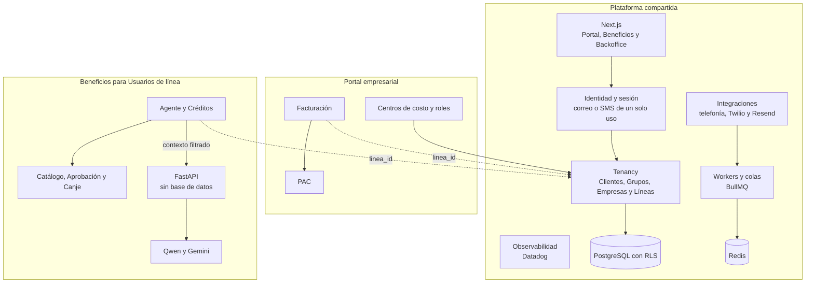
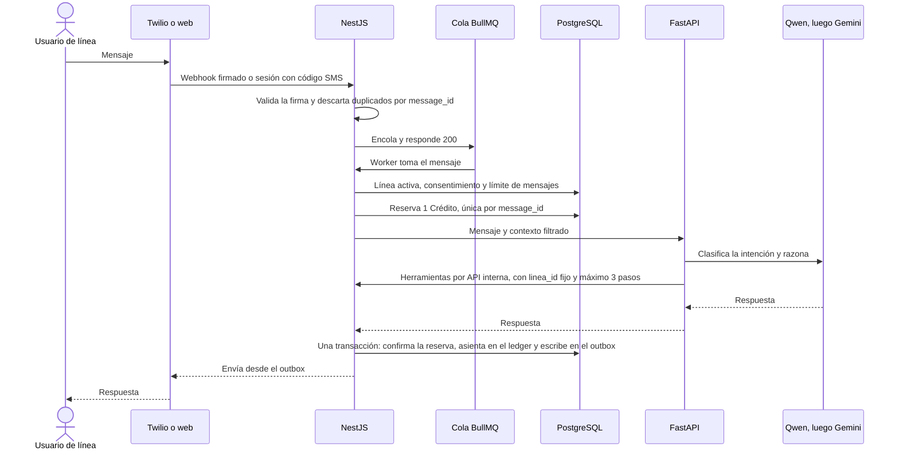

# Gege Tel

Gege Tel es un operador móvil nuevo. Sobre una sola plataforma multiempresa lanza dos productos:

1. **Portal empresarial**: gestión de Líneas, centros de costo y facturación.
2. **Beneficios para Usuarios de línea**: por WhatsApp y web, con agentes de IA.

La arquitectura es un monolito modular en NestJS, un frontend en Next.js y un servicio de IA delgado en FastAPI. Detalle en [`docs/arquitectura.md`](./docs/arquitectura.md).

## Estructura del monorepo

```
gegetel/
├── apps/
│   ├── web/          # Frontend Next.js (Tailwind v4, shadcn, lucide-react)
│   ├── api/          # API NestJS (arquitectura hexagonal)
│   └── design/       # Documentación UX/UI (Diseño Atómico)
├── docs/             # Documentación del proyecto
├── .claude/
│   ├── agents/       # Subagentes de Claude Code
│   └── skills/       # Skills locales (impeccable, setup-matt-pocock-skills)
├── skills-lock.json  # Versión instalada de las skills de skills.sh
├── GLOSSARY.md       # Lenguaje de dominio
└── AGENTS.md         # Instrucciones para agentes de IA
```

## Requisitos

- Node.js 24 (ver [`.nvmrc`](./.nvmrc))
- pnpm 11.6 (`packageManager` en `package.json`)
- [Claude Code](https://claude.com/claude-code) para usar subagentes y skills

## Configuración inicial

```bash
pnpm install
pnpm setup:skills
```

`pnpm setup:skills` instala las skills de Claude Code del proyecto en `.claude/`:

| Skill | Uso |
|---|---|
| `setup-matt-pocock-skills` | Configura issue tracker, labels de triage y docs de dominio para las skills de ingeniería. Ya aplicada en este repo (ver `docs/agents/`); se ejecuta con `/setup-matt-pocock-skills` solo si se reconfigura. |
| `impeccable` | Diseño UX/UI: línea gráfica, auditoría y pulido de interfaces. La usa el subagente `design`. Primera vez en el chat: `/impeccable init`. |

Las skills y los agentes se versionan en git. Lo que depende de cada equipo **no** se versiona y lo genera el script: el binario de `impeccable` según tu sistema operativo y los hooks en `.claude/settings.local.json`, que revisan cambios de UI después de cada edición.

Para actualizar ambas skills: `pnpm update:skills`.

## Scripts

| Comando | Descripción |
|---|---|
| `pnpm install` | Instala dependencias del workspace |
| `pnpm dev:web` | Levanta el frontend en modo desarrollo |
| `pnpm dev:api` | Levanta la API en modo watch |
| `pnpm build` | Compila todos los paquetes |
| `pnpm lint` | Revisa el código con Biome |
| `pnpm format` | Formatea y corrige con Biome |
| `pnpm test` | Ejecuta las pruebas de los paquetes que las tienen |
| `pnpm setup:skills` | Instala skills de Claude Code, binario de `impeccable` y hooks locales |
| `pnpm update:skills` | Actualiza las skills a su última versión |

## Documentación

| Archivo | Contenido |
|---|---|
| [`GLOSSARY.md`](./GLOSSARY.md) | Glosario del dominio (Cliente, Empresa, Grupo, Línea, Créditos…) y términos a evitar |
| [`AGENTS.md`](./AGENTS.md) | Instrucciones base para agentes de IA: plan mode, issue tracker, labels, docs de dominio |
| [`docs/info_inicial.md`](./docs/info_inicial.md) | Resumen del proyecto y hechos establecidos (plazo, equipo, créditos de IA, fuentes de datos) |
| [`docs/arquitectura.md`](./docs/arquitectura.md) | Arquitectura del MVP con diagramas de contexto y componentes |
| [`docs/adr/0001-modelo-de-tenant.md`](./docs/adr/0001-modelo-de-tenant.md) | ADR: el tenant es Cliente, con Grupo opcional sobre Empresas |
| [`docs/adr/0002-aislamiento-con-rls.md`](./docs/adr/0002-aislamiento-con-rls.md) | ADR: aislamiento por Empresa con PostgreSQL compartida y Row-Level Security |
| [`docs/adr/0003-monolito-modular-y-servicio-de-ia.md`](./docs/adr/0003-monolito-modular-y-servicio-de-ia.md) | ADR: monolito modular en NestJS y servicio de IA en FastAPI |
| [`docs/adr/0004-proveedores-de-ia-y-fallback.md`](./docs/adr/0004-proveedores-de-ia-y-fallback.md) | ADR: Qwen como modelo principal, Gemini de respaldo y respuesta en código si ambos fallan |
| [`docs/agents/issue-tracker.md`](./docs/agents/issue-tracker.md) | Uso de GitHub Issues con `gh` CLI |
| [`docs/agents/triage-labels.md`](./docs/agents/triage-labels.md) | Vocabulario de labels de triage |
| [`docs/agents/domain.md`](./docs/agents/domain.md) | Cómo los agentes consumen el glosario y los ADR |
| [`docs/subagentes.md`](./docs/subagentes.md) | Guía de subagentes: cuándo y cómo usar cada uno |
| [`apps/design/`](./apps/design/) | Sistema de diseño UX/UI (pendiente de generar por el subagente `design`) |

## Subagentes de Claude Code

| Agente | Cuándo usarlo |
|---|---|
| `design` | Definir o cambiar UX/UI, tokens y specs en `apps/design/` |
| `frontend` | Implementar UI en `apps/web` según el diseño |
| `backend` | Implementar la API en `apps/api` |
| `synthetic-qa` | Pruebas E2E, visuales y de componentes del frontend (mobile, tablet, desktop) |
| `backend-qa` | Pruebas unitarias, de integración, endpoints y webhooks de la API |

Guía completa, ejemplos y flujo recomendado: [`docs/subagentes.md`](./docs/subagentes.md).

## Convenciones

- Commits con [Conventional Commits](https://www.conventionalcommits.org/), validados por commitlint y Husky.
- Lint y formato con Biome (`pnpm lint`, `pnpm format`).
- Solo `pnpm` como gestor de paquetes.
- **Imports con path alias `@/`**: prohibido `../`; `./` solo dentro de la misma carpeta.
- **Imports mediante barrels (`index.ts`)**: `@/modules/<modulo>`, `@/modules/<modulo>/<capa>`, `@/components/ui`, `@/lib`… En `apps/api` (ESM) con extensión: `@/modules/<modulo>/index.js`.

## Hooks de Claude Code

Definidos en [`.claude/settings.json`](./.claude/settings.json) (versionado; aplican a todo el equipo al abrir el proyecto con Claude Code). Scripts comentados en [`.claude/hooks/`](./.claude/hooks/).

| Hook | Evento | Qué verifica | Si falla |
|---|---|---|---|
| [`guard-git.mjs`](./.claude/hooks/guard-git.mjs) | `PreToolUse` · Bash | Antes de un `git commit` / `git push` de Claude: `apps/*/qa/evidence/` vacía y ningún commit con `Co-authored-by:` | Bloquea el comando: `se deben eliminar los archivos de la carpeta qa/evidence antes de desplegar cambios` / `No se permiten commits con co-author` |
| [`check-imports.mjs`](./.claude/hooks/check-imports.mjs) | `PostToolUse` · Edit, Write | Tras editar código en `apps/`: alias `@/` (sin `../`) e imports mediante barrels | Devuelve el error de Biome a Claude para que corrija los imports |

Además, `includeCoAuthoredBy: false` evita que Claude Code agregue co-autores a sus commits.

Los hooks de git (Husky) solo ejecutan commitlint y `biome check` sobre los archivos en stage.

## Desafío: preguntas y respuestas

### 1. Inicialización y especificaciones (arnés de desarrollo)

> Antes de resolver la arquitectura, prepara el entorno de tu proyecto como si fueras a arrancarlo hoy con este equipo de 4 personas. Define la especificación inicial (usando OpenSpec o el formato de spec-driven development que prefieras) y las reglas/skills para tus agentes de desarrollo. Explica brevemente: ¿qué arnés y modelos elegiste para resolver este desafío, cómo estructuraste el contexto y cómo dividirías el trabajo entre personas y agentes en esas 8 semanas?

**Arnés.** Usé Claude Code con las piezas que ya están versionadas en el repo:

- [`AGENTS.md`](./AGENTS.md): reglas base para los agentes.
- Skills: `mattpocock-skills` para modelar el dominio, cuestionar el plan, escribir la spec, dividirla en tickets y ejecutar el desarrollo en ODD (permitiendo un desarrollo más orgánico) y TDD (realizando testing de todo lo desarrollado); `impeccable` para UX/UI.
- 5 [subagentes](./docs/subagentes.md) con permisos de escritura limitados a su carpeta.
- Hooks: `guard-git` y `check-imports`, además de Husky, commitlint y Biome.

**Modelos.**

| Modelo | Uso |
|---|---|
| Opus 5.5 | Descubrimiento, ADR, spec, tickets y subagente `design` |
| Sonnet 5.5 | Implementación (`frontend`, `backend`) y QA en modo Architect |
| Haiku 5.5 | QA en modo Runner: solo ejecuta las suites existentes |

**Spec-driven.** El proceso fue: definición del proyecto → sesión de preguntas (grilling) → [`GLOSSARY.md`](./GLOSSARY.md) y [ADR](./docs/adr/) → spec del MVP en el [issue #1](https://github.com/ImnotaChickenNuggie/gegetel/issues/1) → 23 tickets verticales (#2–#24) como sub-issues. La spec tiene 98 historias de usuario y tres seams de prueba: API y webhooks, contrato de FastAPI y E2E web. Cada ticket lleva una etiqueta de triage: `ready-for-agent`, `ready-for-human` o `needs-info`.

**Contexto en capas.** Cada capa acota a la siguiente: `AGENTS.md` (reglas) → glosario (lenguaje) → ADR (decisiones que no se reabren) → [arquitectura](./docs/arquitectura.md) → spec → ticket → subagente. El subagente trabaja con su contexto aislado y solo puede escribir en su carpeta.

**Personas y agentes.** Los agentes implementan y prueban los tickets `ready-for-agent`. Las personas deciden, revisan cada PR, conectan las credenciales reales y se ocupan de los tickets `ready-for-human`.

| Persona | Responsable de | Agentes que dirige |
|---|---|---|
| Fullstack A | Portal y Facturación: Líneas → Centros de costo → Factura (#4 → #5 → #6) | `design`, `frontend`, `backend` |
| Fullstack B | Agente de IA: WhatsApp → Agente → Créditos (#7 → #8 → #9) | `backend`, `frontend` |
| DevOps | Entorno, CI, Datadog y respaldos (#3, #24) | — |
| QA | Seams, aislamiento RLS entre Empresas y E2E | `backend-qa`, `synthetic-qa` |

| Semana | Entrega |
|---|---|
| 1 | Esqueleto, RLS, CI y trámites con proveedores |
| 2–3 | Líneas, Centros de costo, WhatsApp y consentimiento |
| 4 | **Hito:** flujo delgado completo en el entorno desplegado (#10) |
| 5–6 | Catálogo, Canje, roles y sincronización con el Proveedor de beneficios |
| 7 | Grupos, privacidad y endurecimiento |
| 8 | Piloto con 5 Empresas y prueba de carga con ~5,000 Líneas |

### 2. Componentes y plataforma compartida

> Diseña los componentes principales de la plataforma (idealmente usando diagramas como código, por ejemplo Mermaid) y marca qué comparten los dos productos y qué queda desacoplado.



| Capa | Qué incluye | Por qué |
|---|---|---|
| Compartido | Frontend, identidad, tenancy y RLS, Líneas, Integraciones, colas, notificaciones, Backoffice, observabilidad y bases de datos | Una sola fuente de verdad para Empresas y Líneas, y un solo despliegue |
| Solo Portal | Centros de costo, roles de Empresa y de Grupo, Facturación y PAC | Reglas fiscales que no necesita Beneficios |
| Solo Beneficios | Catálogo, Aprobación, Canje, Agente, Créditos y servicio de IA | El servicio de IA se despliega aparte y no tiene acceso a datos de negocio |

Los dos productos se conectan solo por `linea_id` y por eventos de dominio. Las fronteras entre módulos se respetan con barrels y el hook `check-imports`, así un módulo se puede extraer sin reescribirlo ([ADR 0003](./docs/adr/0003-monolito-modular-y-servicio-de-ia.md)).

### 3. Aislamiento multi-tenant y seguridad en IA

> ¿Cómo garantizas que una empresa nunca vea ni infiera datos de otra, tanto a nivel de base de datos/API como cuando responde o ejecuta herramientas un agente de IA?

- **Base de datos.** Cada tabla de tenant lleva `empresa_id` y Row-Level Security con `FORCE`. La aplicación se conecta con un rol sin `BYPASSRLS` y fija `SET LOCAL app.empresa_id` en cada transacción. Los roles de Grupo amplían esa política a las Empresas del Grupo ([ADR 0002](./docs/adr/0002-aislamiento-con-rls.md)).
- **API.** La Empresa sale de la sesión, nunca del body ni de los parámetros. Un guard global la aplica, y `backend-qa` incluye pruebas obligatorias de acceso cruzado entre Empresas.
- **Agente de IA.**
  - El servicio de IA no tiene acceso a la base de datos.
  - La Línea se identifica por el número de WhatsApp, validado con la firma del webhook, o en la web por un código de un solo uso enviado por SMS.
  - El contexto contiene solo esa Línea y el Catálogo, que es global.
  - Las herramientas se ejecutan en NestJS con el `linea_id` fijado del lado del servidor, así que el modelo no puede elegir otro tenant.
  - Hay una lista cerrada de herramientas, el Canje pide confirmación, no hay memoria compartida entre Líneas y la caché se indexa por Línea.
- **Inferencia.** El Portal solo muestra cifras agregadas de Créditos y Canjes, y nunca de grupos de menos de 5 Líneas. Los logs no guardan datos personales. Los proveedores de IA no entrenan con los datos ni los retienen.

### 4. Orquestación, resiliencia y control de costos

> Un usuario escribe al asistente por WhatsApp o web. Describe el camino técnico del mensaje y cómo orquestas al agente (o sub-agentes/herramientas) hasta que se descuentan los créditos de forma atómica. ¿Qué pasa si el proveedor principal de IA se cae a mitad de la ejecución? ¿Cómo frenas el impacto si el consumo de tokens o el gasto del día se dispara al doble, sin romperle la experiencia a todos los clientes?



**Descuento atómico.** La reserva es un `UPDATE … WHERE disponibles - reservados >= 1` con una restricción única por `message_id`, así que dos mensajes concurrentes o un webhook repetido no descuentan dos veces. La confirmación, el asiento en el ledger (solo se agrega, nunca se edita) y el mensaje de salida se guardan en la misma transacción.

**Si el proveedor principal cae a mitad de la ejecución** ([ADR 0004](./docs/adr/0004-proveedores-de-ia-y-fallback.md)):

1. Cada llamada tiene un timeout y un circuit breaker por proveedor.
2. Si Qwen falla, se repite en Gemini Flash con el contexto completo. Las llamadas no guardan estado, así que se puede reenviar, y las herramientas son idempotentes, por lo que un Canje nunca se duplica.
3. Si también falla Gemini, NestJS envía una respuesta escrita en código con los Créditos, los Beneficios destacados y el enlace al Catálogo. En ese caso se libera la reserva y el Crédito no se consume.
4. Un proceso periódico libera las reservas que quedaron vencidas.

Si los requisitos se vuelven más complejos, se puede sumar un modelo GPT o superior a la cadena, adicionalmente comenté Qwen y Gemini, pero también se podría utilizar una IA local alojada en un VPS, lo cual modificaría mi arquitectura propuesta pero es viable.

**Si el gasto se duplica:**

- Los Créditos ya limitan cada Línea (100 en básico, 300 en premium). Además hay `max_tokens`, recorte del contexto y un máximo de pasos por herramienta.
- Hay presupuesto diario por Empresa y global, y detección de anomalías por Línea y por Empresa: si una Línea o una Empresa provoca el pico, se le limita solo a ella.
- Escalones: al **150%** del gasto esperado, alerta en Datadog. Al **200%**, se degrada a un modelo más barato con contexto corto, sin sub-agentes y con respuestas frecuentes desde caché. Al llegar al **techo** de gasto, responde el código.
- El pico de un tenant nunca deja sin servicio a los demás.

### 5. Estrategia de ejecución (8 semanas / 4 personas)

> Menciona tres servicios o componentes que comprarías o usarías ya hechos en lugar de construirlos desde cero, y los tres riesgos técnicos o de producto que más te preocupan de este lanzamiento (y cómo los mitigarías).

**Comprar en lugar de construir:**

| Servicio | Para qué | Evolución |
|---|---|---|
| PAC con API (Facturama o SW Sapien) | Timbrado y cancelación de CFDI 4.0, con sandbox | — |
| Twilio para WhatsApp | Plantillas, aprobación de Meta y webhooks firmados | Migrar a Meta Cloud API y, más adelante, quizá a un servicio propio |
| Resend | Correos transaccionales (invitaciones, Facturas) | Migrar a Amazon SES |
| *Extra:* Datadog | Alertas, tráfico del servidor y gasto de IA | — |

**Riesgos principales:**

1. **Nadie del equipo tiene perfil de IA y el alcance es grande.** Mitigación: hito de semana 4 con un flujo delgado, un Agente simple con evaluaciones básicas y el recorte ya acordado (la sincronización del Catálogo se aplaza y se carga a mano).
2. **Fuga de datos entre tenants o prompt injection.** Mitigación: RLS, pruebas obligatorias de aislamiento, servicio de IA sin base de datos y herramientas atadas a la Línea.
3. **Dependencias externas:** aprobación de Meta y Twilio, paso del PAC de sandbox a producción, envío de SMS por el Proveedor de telefonía y un Proveedor de beneficios que no notifica cambios. Mitigación: iniciar los trámites en la semana 1, desarrollar contra dobles en los seams y detectar cambios del Catálogo con polling y comparación.
