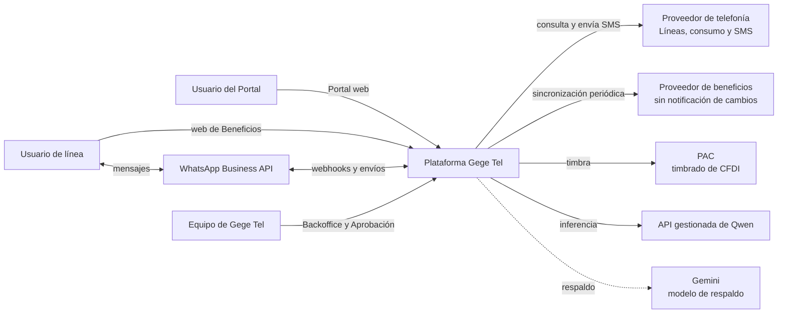
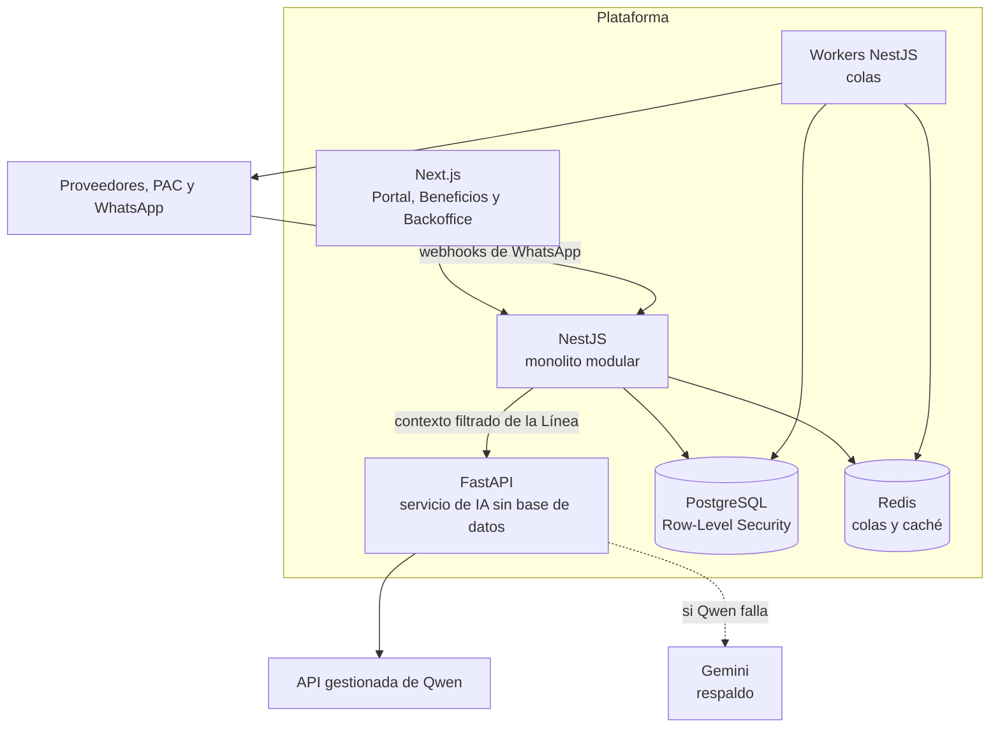
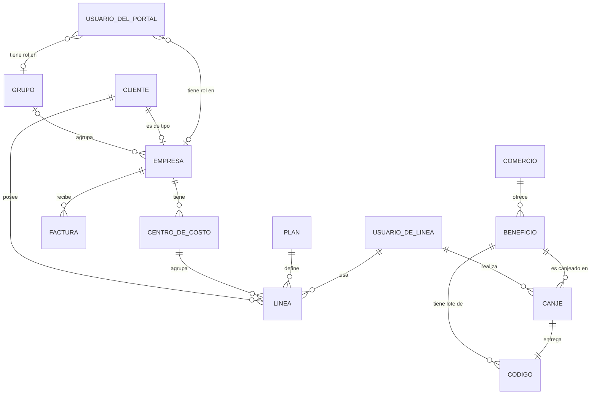
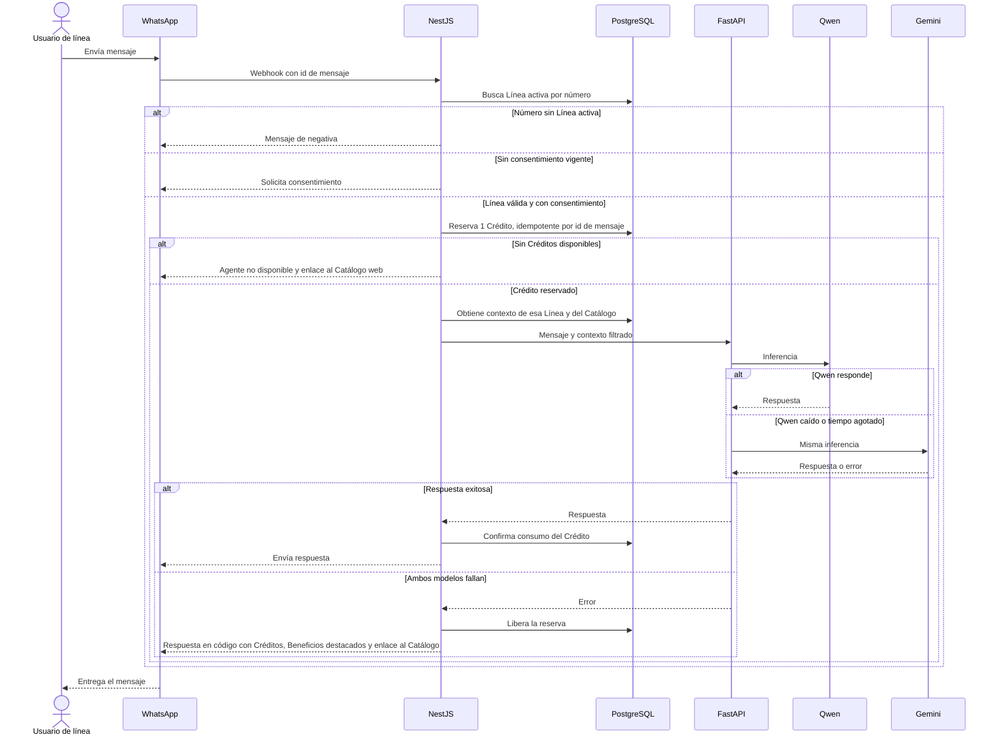
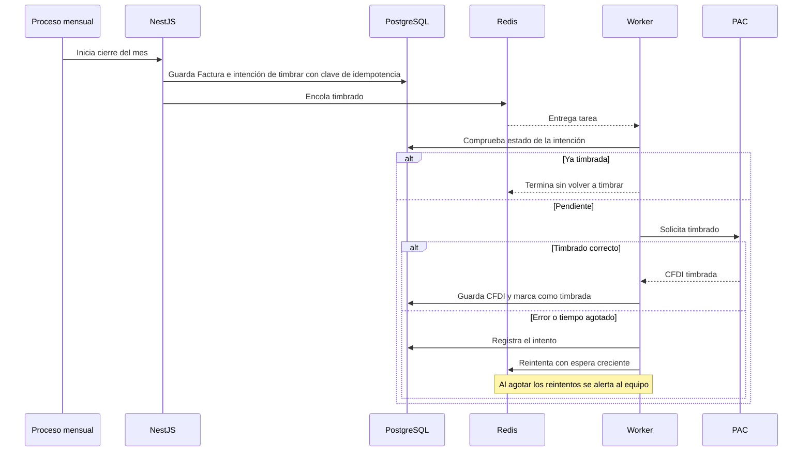
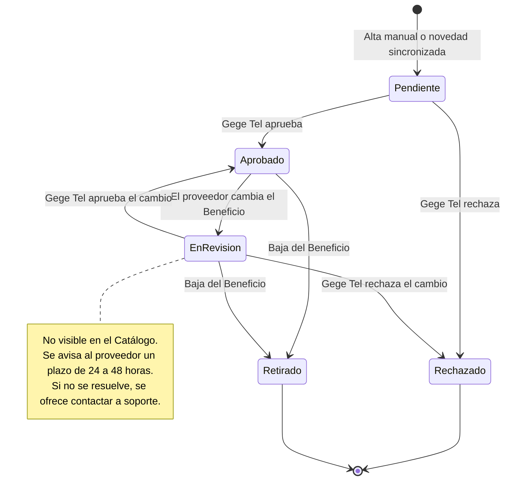
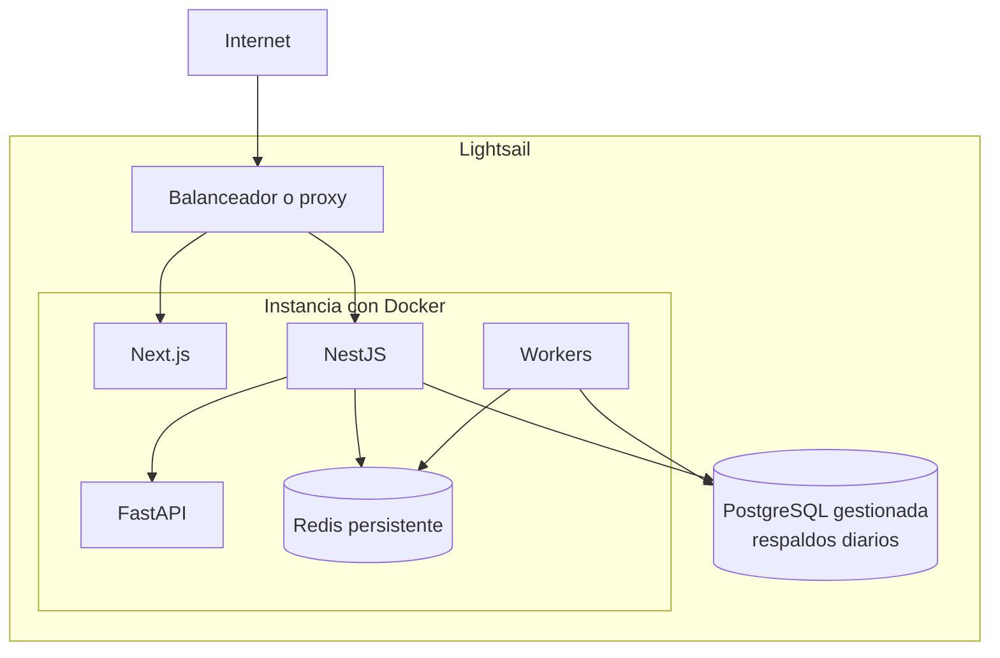
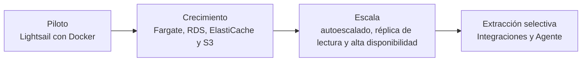

# Arquitectura de Gege Tel

> **PENDIENTE (otro plan):** página exportable a PDF con estos diagramas para presentar al equipo.

## Resumen

Gege Tel lanza en 8 semanas, con 2 fullstack, 1 DevOps y 1 QA, un MVP cerrado a 5 Empresas con dos productos: el Portal empresarial y los Beneficios para Usuarios de línea. La arquitectura es un monolito modular en NestJS más un servicio de IA delgado en FastAPI. En la semana 4 se valida un flujo completo delgado.

El vocabulario está en [`GLOSSARY.md`](../GLOSSARY.md) y las decisiones difíciles de revertir, en [`docs/adr/`](./adr/).

## Contexto

## Stack

| Pieza | Tecnología | Por qué |
|---|---|---|
| Web (Portal, Beneficios, Backoffice) | Next.js | Un solo frontend para las tres superficies. |
| Backend | NestJS | Módulos con fronteras claras y un solo despliegue. |
| Base de datos principal | PostgreSQL | Transacciones para Factura y Créditos, y Row-Level Security para el aislamiento. |
| Colas y caché | Redis | Tareas asíncronas con reintentos y caché. |
| Servicio de IA | FastAPI | Ecosistema de IA en Python, en un servicio delgado y sin datos de negocio. |
| Modelo | Qwen por API gestionada, con Gemini Flash de respaldo | Sin operar GPUs. Con una interfaz compatible con OpenAI se cambia de modelo sin tocar el resto, y si ambos fallan responde el código ([ADR 0004](./adr/0004-proveedores-de-ia-y-fallback.md)). |

Redis no es el registro único de una tarea crítica: la intención de timbrar se guarda primero en PostgreSQL.

## Contenedores

## Módulos del monolito

| Módulo | Responsabilidad |
|---|---|
| Portal | Clientes, Grupos, Empresas, roles, Líneas y Centros de costo. |
| Facturación | Factura mensual por Empresa, desglose por Centro de costo y timbrado. |
| Catálogo | Comercios, Beneficios, Aprobación, lotes de Códigos y Canjes. |
| Agente | Identidad, consentimiento, Créditos y conversación con el servicio de IA. |
| Integraciones | Adaptadores de Proveedor de telefonía, Proveedor de beneficios, PAC, WhatsApp y SMS. |

## Modelo de dominio

Solo se crean Clientes de tipo Empresa en el MVP. Las Líneas se asocian al Cliente y, dentro de una Empresa, a exactamente un Centro de costo.

## Mensaje de WhatsApp al Agente de IA

El Crédito se consume solo con una respuesta exitosa. Se reserva antes de llamar al modelo para evitar el doble descuento por mensajes concurrentes o webhooks repetidos. Si Qwen falla, la misma inferencia se repite en Gemini. Si también falla Gemini, se libera la reserva y el código envía una respuesta determinista ([ADR 0004](./adr/0004-proveedores-de-ia-y-fallback.md)).

## Factura y timbrado

La clave de idempotencia evita duplicar una CFDI aunque un worker reintente o Redis falle.

Un proceso periódico vuelve a encolar las intenciones pendientes, por si una tarea se pierde en Redis.

## Estados de un Beneficio

Solo un Beneficio en estado Aprobado aparece en el Catálogo.

## Aislamiento y seguridad

- **Datos por Empresa:** cada tabla de tenant lleva identificador de Empresa y Row-Level Security. La aplicación se conecta con un usuario que no puede omitir esas políticas ([ADR 0002](./adr/0002-aislamiento-con-rls.md)).
- **Roles de Grupo:** las políticas se extienden a las Empresas de ese Grupo.
- **Servicio de IA:** sin acceso a la base de datos; solo recibe el contexto de la Línea ([ADR 0003](./adr/0003-monolito-modular-y-servicio-de-ia.md)).
- **Identidad en WhatsApp:** el número debe coincidir con una Línea activa, con consentimiento en el primer contacto.
- **Acceso web:** número de Línea y código de un solo uso por SMS.
- **Privacidad:** los Usuarios del Portal solo ven cifras agregadas de Créditos y Canjes, nunca el contenido de las conversaciones.
- **Reasignación de Línea:** los Créditos siguen con la Línea; historial y consentimiento no se transfieren.

### Roles del Portal

| Nivel | Rol | Alcance |
|---|---|---|
| Empresa | Administrador | Todo, incluidos usuarios. |
| Empresa | Finanzas | Facturas y Centros de costo. |
| Empresa | Responsable de centro de costo | Solo las Líneas de su centro. |
| Grupo | Administrador | Todo en sus Empresas. |
| Grupo | Finanzas | Facturas y consolidados. |
| Grupo | Gestión | Altas y bajas de Usuarios de línea y del Portal, y solicitudes de altas o bajas de Líneas. No ve facturas, datos fiscales ni detalle de consumo. |

## Despliegue

### MVP en Lightsail

### Evolución

Las mismas imágenes Docker se mueven a servicios gestionados a medida que el sizing lo requiera.

## Sizing

Estimaciones aproximadas, a validar con pruebas de carga. La meta firme es el piloto; las otras etapas son referencia.

| Etapa | Empresas | Líneas | Infraestructura orientativa |
|---|---|---|---|
| Piloto | 5 | ~5,000 | Lightsail con Docker y PostgreSQL gestionada. |
| Crecimiento | ~25 | ~25,000 | Fargate, RDS, ElastiCache y S3. |
| Referencia a 12 meses | ~100 | ~100,000 | Autoescalado de API y workers, réplica de lectura y alta disponibilidad; evaluar extraer Integraciones y Agente. |

API y workers no guardan estado, para poder escalar horizontalmente. Se extrae un microservicio solo cuando un módulo tenga necesidades propias de escala o despliegue.

## Riesgos y pendientes

- **Sin perfil de IA en el equipo:** 2 fullstack cubren producto, integraciones y agente antes del hito de semana 4. Es el mayor riesgo de plazo.
- **Lightsail:** hay que confirmar región disponible y su límite de redes, y asumir el punto único de falla de Redis durante el piloto.
- **Proveedores de IA (Qwen y Gemini):** ambos contratos deben ser compatibles con la ley mexicana de datos personales, y hay que verificar región de datos, retención cero y no entrenamiento.
- **Gasto de IA:** además del límite de Créditos por Línea, hay presupuesto diario por Empresa y global. Al 150% del gasto esperado se alerta; al 200% se degrada a contexto corto y modelo más barato, cortando solo a la Línea o Empresa que lo provoca. En el techo de gasto se usa la respuesta en código.
- **CFDI consolidada:** requiere validación de un contador antes de habilitarse; va después del MVP.
- **SMS:** hay que confirmar que la API del Proveedor de telefonía permite enviarlos.
- **Proveedor de beneficios y Comercio:** se asume que el proveedor suministra Beneficios de varios Comercios y puede entregar lotes de Códigos.
- **Recorte acordado:** si no se alcanza el hito de semana 4, primero se aplaza la sincronización con el Proveedor de beneficios y el Catálogo se carga a mano.
