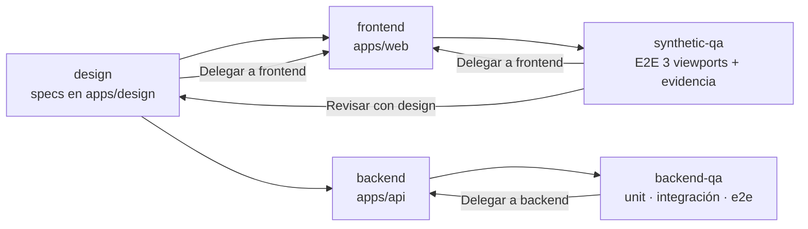

# Subagentes de Claude Code

Guía para saber **cuándo** y **cómo** usar cada subagente del proyecto. Las definiciones viven en [`.claude/agents/`](../.claude/agents/).

## ¿Qué es un subagente?

Un subagente es un asistente especializado con instrucciones, herramientas y modelo propios. Claude Code le delega una tarea, el subagente trabaja en un contexto aislado y devuelve un reporte a la conversación principal.

### Cómo invocarlo

- **Lenguaje natural**: "usa el subagente `frontend` para implementar el login según `apps/design`".
- **Mención directa**: `@frontend implementa el login`.
- **Listar / editar**: comando `/agents` en Claude Code.
- **Automático**: Claude puede elegirlo solo cuando la tarea coincide con la `description` del agente, pero es mejor nombrarlo explícitamente.

> Un subagente **no puede invocar a otro**. Cuando un agente necesita trabajo de otro, lo deja en su reporte (secciones "Delegar a …" / "Revisar con design") y la conversación principal lanza al siguiente.

## Resumen

| Agente | Responsabilidad | Modelo | Escribe en | Nunca hace |
|---|---|---|---|---|
| [`design`](../.claude/agents/design.md) | UX/UI, sistema de diseño, Diseño Atómico | `opus` | `apps/design/*.md` | Editar código |
| [`frontend`](../.claude/agents/frontend.md) | Implementar UI en Next.js | `sonnet` | `apps/web` | Diseñar fuera de `apps/design` |
| [`backend`](../.claude/agents/backend.md) | Implementar API NestJS | `sonnet` | `apps/api` | Redefinir reglas de negocio o ADRs |
| [`synthetic-qa`](../.claude/agents/synthetic-qa.md) | QA frontend: E2E, visual, componentes | `sonnet` / `haiku` | Pruebas de `apps/web`, `qa/evidence/` | Modificar código de producción |
| [`backend-qa`](../.claude/agents/backend-qa.md) | QA backend: unit, integración, endpoints, webhooks | `sonnet` / `haiku` | Pruebas de `apps/api` | Modificar código de producción |

### Agentes internos de `impeccable`

`pnpm setup:skills` también instala cuatro agentes que usa la skill `impeccable` durante sus propios flujos. **No se invocan directamente** ni se editan a mano, porque se sobrescriben al actualizar:

| Agente | Lo usa impeccable para |
|---|---|
| `impeccable-asset-producer` | Producir assets raster a partir de mocks aprobados |
| `impeccable-documenter` | Documentar `DESIGN.md` a partir de lo construido |
| `impeccable-finish-reviewer` | Revisar un build terminado contra la dirección de diseño |
| `impeccable-manual-edit-applier` | Aplicar ediciones manuales de copy en vivo |

## Fichas

### `design`

- **Llámalo cuando**: inicias el sistema de diseño, defines una pantalla o flujo nuevo, cambias tokens/tipografía, o QA reporta una discrepancia visual.
- **No lo llames para**: escribir componentes, CSS o tocar `globals.css` (eso es `frontend`).
- **Primera ejecución**: si `apps/design/` está vacía, invoca la skill `impeccable` y crea `1-atoms.md` … `5-pages.md` y `DESIGN.md`.
- **Ejemplos**:
  - "Inicializa el sistema de diseño."
  - "Especifica la página de listado de Líneas con estados empty, loading y error."
- **Entrega**: `.md` actualizados, decisiones, **Delegar a frontend**, cambios que requieren aprobación.

### `frontend`

- **Llámalo cuando**: hay que implementar páginas, componentes, hooks de TanStack Query o aplicar cambios de tokens en `apps/web`.
- **No lo llames para**: decidir diseño (primero `design`) ni escribir suites E2E (eso es `synthetic-qa`).
- **Reglas clave**: shadcn + Tailwind v4 + lucide-react, `cva` + `mergeClasses`, arquitectura hexagonal en `src/modules/<feature>/`, aviso si Next.js no es LTS.
- **Ejemplos**:
  - "Implementa el componente `LineCard` según `apps/design/2-molecules.md`."
  - "Aplica el bloque 'Cambio de tokens' que entregó design."
- **Entrega**: archivos tocados, resultado de `pnpm lint`, avisos, sugerencias.

### `backend`

- **Llámalo cuando**: hay que crear módulos, casos de uso, repositorios Prisma, controllers, webhooks, colas BullMQ o correos MJML en `apps/api`.
- **No lo llames para**: cambiar decisiones de `docs/adr/` o el glosario sin acordarlo antes.
- **Reglas clave**: hexagonal con tokens `Symbol`, RLS por Empresa (ADR 0002), IA solo vía puerto (ADR 0003), idempotencia con Redis, aviso si NestJS no es LTS.
- **Ejemplos**:
  - "Crea el módulo de Líneas con su repositorio Prisma y endpoint de listado."
  - "Implementa el webhook del proveedor de telefonía con verificación de firma."
- **Entrega**: archivos tocados, resultado de `pnpm lint`, avisos (deps faltantes), sugerencias.

### `synthetic-qa`

- **Llámalo cuando**: hay que crear o ejecutar pruebas E2E, visuales o de componentes de `apps/web`.
- **No lo llames para**: corregir bugs de la UI (los reporta en **Delegar a frontend**).
- **Reglas clave**: Playwright con POM y selectores accesibles, **siempre** en mobile (390×844), tablet (768×1024) y desktop (1440×900); evidencia en `apps/web/qa/evidence/<fecha>/` (ignorada por git).
- **Ejemplos**: ver [Modos QA](#modos-qa-runner-y-architect).
- **Entrega**: resultado por viewport, ruta a evidencia, **Delegar a frontend**, **Revisar con design**.

### `backend-qa`

- **Llámalo cuando**: hay que crear o ejecutar pruebas de `apps/api`: dominio, casos de uso, Prisma, aislamiento RLS, endpoints, webhooks, colas.
- **No lo llames para**: corregir bugs de la API (los reporta en **Delegar a backend**).
- **Reglas clave**: Vitest, `vitest-mock-extended` para Prisma, Testcontainers para integración real, pruebas obligatorias de aislamiento entre Empresas.
- **Ejemplos**: ver [Modos QA](#modos-qa-runner-y-architect).
- **Entrega**: resultados, cobertura, **Delegar a backend**, avisos (Docker, deps).

## Modos QA: Runner y Architect

Los agentes QA usan `sonnet` por defecto. El modelo se elige **al invocarlos** según el modo:

| Modo | Modelo | Qué hace | Ejemplo |
|---|---|---|---|
| Runner | `haiku` | Solo ejecuta pruebas existentes y reporta | "Usa `synthetic-qa` con haiku: corre las pruebas e2e de la app web." |
| Architect | `sonnet` | Diseña, genera y ejecuta suites | "Usa `backend-qa`: diseña la suite de pruebas del módulo de pagos." |

En modo Runner, si falta cobertura o una prueba está rota, el agente lo reporta para una ejecución Architect en vez de escribirla.

## Flujo recomendado para una feature



1. **design** especifica la pantalla/flujo en `apps/design/`.
2. **backend** implementa los endpoints y casos de uso necesarios.
3. **frontend** implementa la UI según el diseño, consumiendo la API mediante sus módulos.
4. **backend-qa** y **synthetic-qa** generan y ejecutan pruebas (modo Architect).
5. Los hallazgos de cada reporte se reenvían al agente indicado.
6. Revisión humana de la evidencia en `apps/web/qa/evidence/`.
7. En iteraciones posteriores, correr las suites en modo Runner (`haiku`).

## Reglas comunes

- Comandos siempre con `pnpm` scoped (`pnpm --filter web …`, `pnpm --filter api …`); nunca `npm`, `yarn` ni `npx`.
- Avisan si Next.js / NestJS / Node no están en versión LTS; no actualizan sin aprobación.
- Instalan dependencias solo con aprobación.
- Verifican con `pnpm lint` (los QA además ejecutan sus pruebas).
- Usan el vocabulario de [`GLOSSARY.md`](../GLOSSARY.md) y respetan [`docs/adr/`](./adr/).
- Imports siempre con alias `@/` y mediante barrels (`index.ts`); `../` está prohibido. Lo valida el hook de Claude `check-imports` tras cada edición (y Biome en `pnpm lint`).
- Nunca agregan `Co-authored-by:` a commits, y `apps/web/qa/evidence/` debe vaciarse antes de cualquier commit o push (el hook de Claude `guard-git` lo bloquea). Ver [Hooks de Claude Code](../README.md#hooks-de-claude-code).

## Agregar o modificar un subagente

Cada agente es un `.md` en `.claude/agents/` con frontmatter:

```yaml
---
name: nombre-del-agente      # minúsculas y guiones
description: Cuándo usarlo   # Claude lo usa para decidir delegar
tools: Read, Edit, Write     # herramientas permitidas
model: sonnet                # opus | sonnet | haiku
---
```

El cuerpo contiene las instrucciones del agente. Tras editarlo, verifica con `/agents` y actualiza esta guía.
